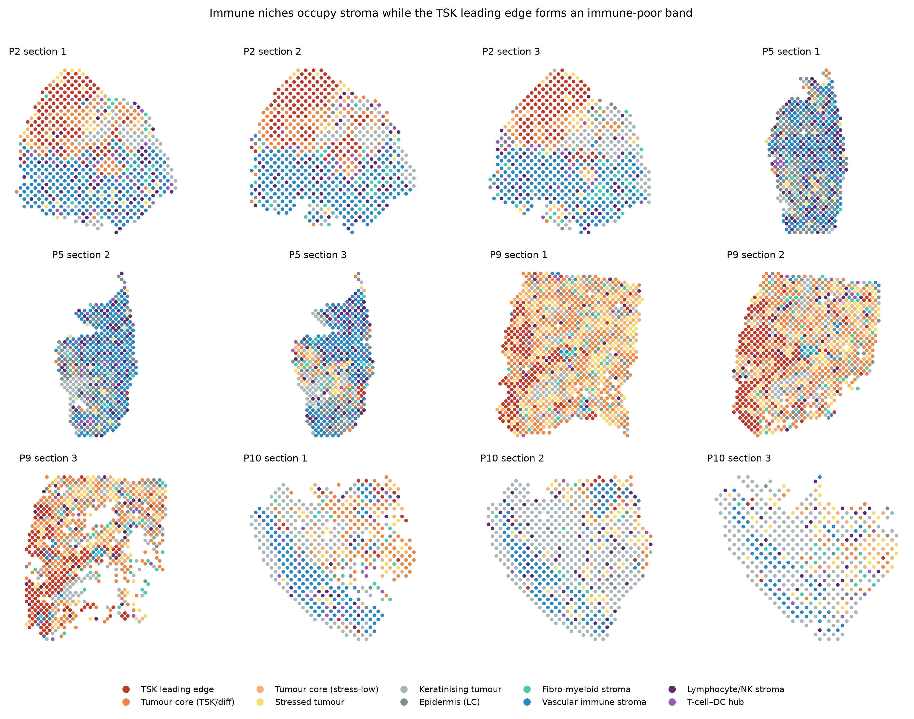
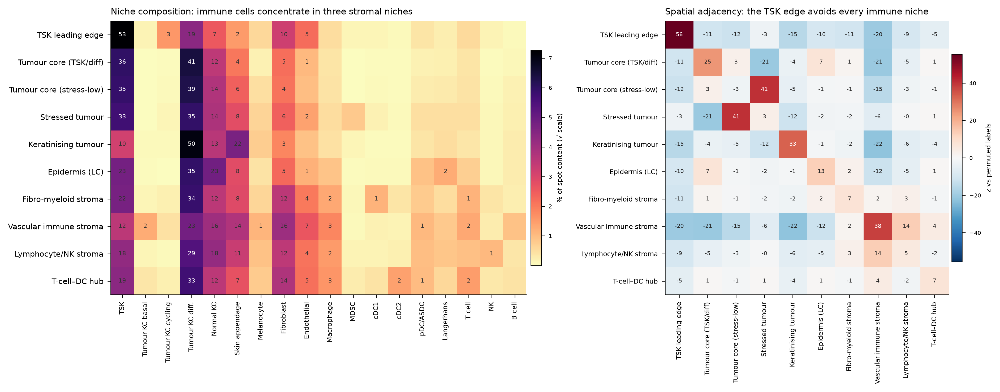

# Tumour-immune niche map of cutaneous squamous cell carcinoma

Spatial niche mapping of 12 spatial-transcriptomics sections from four cSCC tumours,
deconvolved against the matched single-cell reference from the same study.

**Data:** [GEO GSE144240](https://www.ncbi.nlm.nih.gov/geo/query/acc.cgi?acc=GSE144240)
(Ji et al., *Cell* 2020) — `GSE144239` spatial (8,178 spots, 15,243 genes, patients P2/P5/P9/P10
x 3 replicates), `GSE144236` scRNA-seq reference (48,164 cells).
No data files are committed; `niche_mapping_pipeline.py` downloads them from GEO.

## Headline result

The TSK (tumour-specific keratinocyte) leading edge is **immunologically sealed off**. It is the
most spatially coherent niche in the dataset — self-adjacency z = 55.6 against within-section
label permutation — and is significantly depleted of contact with every immune niche:

| neighbour niche | adjacency z |
|---|---|
| vascular immune stroma | -20.3 |
| lymphocyte/NK stroma | -9.2 |
| T-cell-DC hub | -5.3 |

Yet CXCR3-ligand signalling is *specific* to that edge: `CXCL9`-`CXCR3` scores z = 4.7 and
`CXCL11`-`CXCR3` z = 3.8 across TSK-edge-to-immune spot pairs, versus z = 0.1 and 0.3 for
tumour-core-to-immune pairs — a recruitment/exclusion mismatch.

Immune cells track vasculature and fibroblasts rather than tumour: every immune type correlates
positively with endothelium (rho 0.20-0.45) and fibroblasts (rho 0.17-0.47), negatively with
differentiated tumour keratinocytes (rho -0.11 to -0.37), and ~zero with TSK (rho -0.07 to +0.02).




## Niches

All ten niches are present in all four patients. Percentages are deconvolved spot content.

| niche | spots | immune % | TSK % | fibroblast % | endothelial % |
|---|---|---|---|---|---|
| TSK leading edge | 902 | 0.81 | 52.7 | 10.5 | 5.0 |
| Tumour core (TSK/diff) | 1244 | 0.4 | 35.8 | 4.8 | 1.1 |
| Tumour core (stress-low) | 767 | 0.53 | 34.7 | 4.5 | 1.0 |
| Stressed tumour | 530 | 1.67 | 32.8 | 5.8 | 1.9 |
| Keratinising tumour | 1347 | 0.8 | 10.1 | 3.4 | 0.8 |
| Epidermis (LC) | 577 | 3.85 | 22.8 | 5.2 | 1.4 |
| Fibro-myeloid stroma | 351 | 5.56 | 22.4 | 12.4 | 4.1 |
| Vascular immune stroma | 1577 | 7.83 | 12.4 | 16.5 | 6.8 |
| Lymphocyte/NK stroma | 674 | 6.21 | 18.3 | 12.3 | 4.4 |
| T-cell–DC hub | 210 | 8.69 | 19.2 | 14.2 | 4.7 |

## Method

1. **Signature matrix** — 24 level-2 scRNA labels collapsed to 18 deconvolution targets (four
   tumour-keratinocyte states kept separate, normal keratinocytes merged, immune kept resolved).
   Built by streaming the count matrix gene-by-gene so 48k cells never sit in memory at once.
2. **Deconvolution** — Poisson EM, `y_g ~ Poisson(sum_k n_k * s_gk)`. This is the RCTD likelihood
   without per-gene overdispersion. Gaussian NNLS was tried first and collapses onto a few
   collinear keratinocyte profiles; Poisson EM does not:

   | validation (rho vs marker genes in same spot) | NNLS | Poisson EM |
   |---|---|---|
   | macrophage (`CD68`/`CD163`/`C1QA`/`C1QB`) | 0.10 | **0.68** |
   | fibroblast (`COL1A1`/`COL1A2`/`DCN`/`LUM`) | 0.86 | 0.77 |
   | endothelial (`PECAM1`/`VWF`/`CLDN5`) | 0.35 | **0.53** |
   | T cell (`CD3D`/`CD3E`/`CD2`/`TRBC2`) | 0.20 | **0.43** |

3. **Niche clustering** — Leiden (res 0.4) on own + 8-neighbour-averaged composition,
   Harmony-integrated over patient. Without integration niches are patient-specific
   (mixing entropy ~0.2-0.3 of max 1); with it, median mixing is 0.82.
4. **Statistics** — niche adjacency and ligand-receptor scores against 500 / 300 within-section
   label permutations; cell-type co-localisation as within-patient Spearman, averaged.

## Caveats

- Legacy ST platform: ~100 um spots, median 1,573 counts/spot. Read rankings and contrasts,
  not absolute percentages.
- The ligand-receptor panel is a curated TME list, not an unbiased database screen — the
  platform is too shallow for that.
- Assumption/residual diagnostics were not assessed.

## Running it

```bash
conda env create -f environment.yml
conda activate cscc
python niche_mapping_pipeline.py
```

## Layout

```
niche_mapping_pipeline.py   full pipeline, from GEO download to statistics
figures/                    niche maps; composition + adjacency heatmaps
results/
  niche_summary.csv             per-niche spot counts and immune fractions
  niche_cell_composition.csv    niche x 18 cell types
  niche_adjacency_zscores.csv   permutation-tested adjacency
  celltype_colocalisation.csv   within-patient co-localisation matrix
  lr_interface_scores.csv       ligand-receptor, tumour core vs TSK edge
  spot_niche_table.csv          per-spot coordinates, niche, 18 proportions
```
